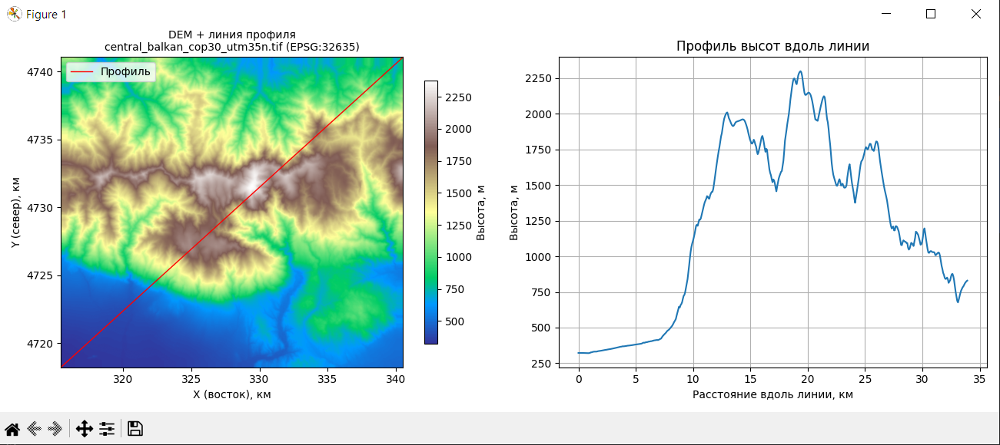
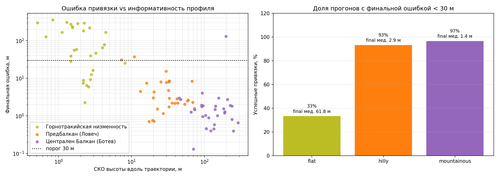

# Terrain-Relative Navigation

Мне стало интересно, можно ли уточнять положение беспилотника по рельефу, если начальные координаты известны неточно. Я разработала прототип **terrain-relative navigation (TRN)**: он сопоставляет профиль высот вдоль маршрута с цифровой моделью рельефа и оценивает положение с помощью фильтра частиц.

Проект помог мне разобраться, как устроен такой алгоритм и от чего зависит его точность. Я проверяла его на синтетических картах и на реальных DEM Copernicus GLO-30 для трёх районов Болгарии — от равнинной местности до гор.

## Что делает программа

- Загружает цифровую модель рельефа из GeoTIFF или создаёт синтетическую.
- Показывает карту местности, линию маршрута и профиль высот вдоль неё.
- Моделирует измерения высоты с шумом, смещением датчика и отдельными выбросами.
- Пошагово оценивает координаты с помощью фильтра частиц: прогнозирует движение, сопоставляет измеренную высоту с картой, обновляет веса частиц и при необходимости выполняет ресемплинг.
- Сравнивает работу алгоритма при разном рельефе, начальной ошибке и количестве частиц.
- Считает метрики точности: RMSE, финальную ошибку, время сходимости и долю успешных прогонов.

## Как выглядит работа с рельефом

На левой части изображения показана карта высот и выбранная линия маршрута, на правой — профиль высоты вдоль этой линии. Для TRN важна форма этого профиля: на участках с заметными перепадами высот алгоритму проще отличить одну область карты от другой.



## Что показали эксперименты

Для каждого типа реального рельефа я запускала по 30 случайных маршрутов длиной 3 км. В этих экспериментах начальная ошибка положения задавалась примерно в 100 м, использовались 5000 частиц и шум измерения высоты 1 м. Успешным считался прогон, в котором финальная ошибка была меньше 30 м.

| Участок | Тип рельефа | Успешные прогоны | Медианная финальная ошибка |
|---|---|---:|---:|
| Горнотракийская низменность | Равнина | 33% | 61,8 м |
| Предбалкан, район Ловеча | Холмистый | 93% | 2,9 м |
| Центральный Балкан, район Ботева | Горный | 97% | 1,4 м |

На этой серии симуляций лучше всего алгоритм работал на холмистом и горном рельефе. На равнине профиль высот часто недостаточно выразительный, и фильтр может ошибочно привязаться к похожему участку. Для меня это один из главных выводов проекта: точность зависит не только от настроек фильтра, но и от того, насколько информативен сам рельеф вдоль маршрута.



## Что важно учитывать

Это **исследовательский прототип и симуляция**, а не готовая система для управления БПЛА. Измерения в эксперименте моделируются по той же DEM, с которой работает фильтр; курс и скорость считаются известными. 

## Запуск

Установить зависимости и запустить эксперимент на DEM, которые входят в проект:

```bash
python -m venv .venv
# Windows PowerShell:
.venv\Scripts\Activate.ps1
python -m pip install -r requirements.txt
python -m scripts.experiment_real_terrain --config config.yaml
```

Для интерактивного просмотра карты и профиля запустите приложение из каталога `src`:

```bash
cd src
python main.py
```

Подробное описание алгоритма, дополнительных экспериментов и ограничений — в [REPORT.md](REPORT.md). Основные параметры запуска находятся в [config.yaml](config.yaml).

## Структура проекта

- `src/` — фильтр частиц, модель рельефа, траектории, измерения и визуализация.
- `scripts/` — диагностические скрипты и эксперименты.
- `tests/` — модульные тесты.
- `data/raw/` — использованные модели рельефа.
- `results/` — графики и логи прогонов.
